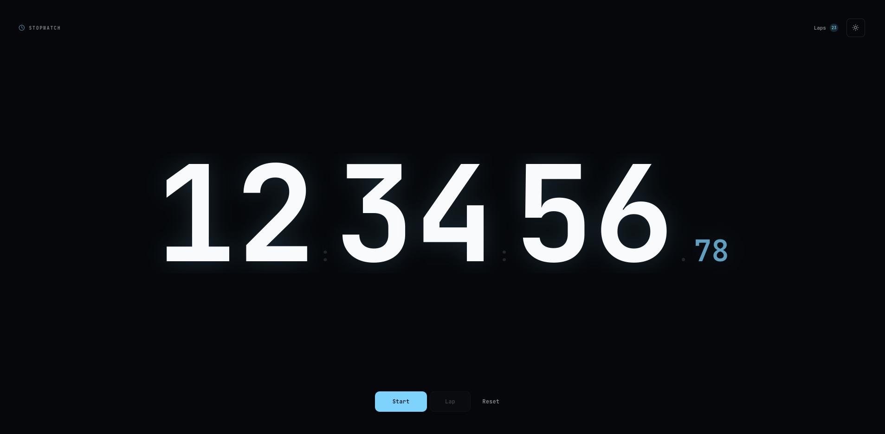

[](https://github.com/mcckyle/react-stopwatch/actions/workflows/deploy.yml)
[](./LICENSE)

# react-stopwatch

A simple, modern stopwatch built with **React** and **Vite**.

Designed around a fullscreen digital display and a distraction-free interface. Features include keyboard shortcuts, persistent lap history, lap comparisons, and adaptive light and dark themes.

[**Live Demo →**](https://mcckyle.github.io/react-stopwatch/)



---

## Features

- Fullscreen digital stopwatch with an expansive time display
- High-resolution timing using the browser's monotonic clock
- Centisecond display precision
- Start, pause, reset, and lap controls
- Keyboard shortcuts for common operations
- Persistent lap history using `localStorage`
- Individual lap deletion and lap history management
- Lap duration comparisons
- Fastest and slowest lap highlighting
- Adaptive light and dark themes
- System color preference detection
- Responsive desktop and mobile layouts
- Accessible controls and semantic HTML
- Visible keyboard focus indicators
- Reduced-motion support
- Native CSS and CSS modules without a UI framework

### Keyboard shortcuts

| Key | Action |
| --- | --- |
| `Space` | Start / pause |
| `L` | Record lap |
| `R` | Reset |
| `Shift + ?` | Open keyboard shortcuts |

---

## Technology Stack

| Technology | Purpose |
| --- | --- |
| [React](https://react.dev/) | Component-based user interface |
| [Vite](https://vite.dev/) | Development server and production builds |
| JavaScript (ES Modules) | Application logic and stopwatch functionality |
| CSS | Design system and responsive layouts |
| CSS Modules | Component-scoped styling |
| `requestAnimationFrame` | Efficient display synchronization |
| `performance.now()` | High-resolution monotonic timing |
| `localStorage` | Persistent lap history |
| Vitest | Unit and component testing |
| React Testing Librarry | Component interaction and accessibility testing |

---

## Getting Started

### Prerequisites

- Node.js
- npm

### Installation

Clone the repository and install dependencies:

```bash
git clone https://github.com/mcckyle/react-stopwatch.git
cd react-stopwatch
npm install
```

### Development

Start the development server:

```bash
npm run dev
```

### Production Build

Generate an optimized production build:

```bash
npm run build
```

---

## Project Structure

```
react-stopwatch/
├── .github/
│   └── workflows/        # GitHub Actions workflows (CI/CD).
│
├── public/
│   └── images/           # Static application assets.
│
├── src/                  # Application Source code.
│   ├── components/       # Reusable React components.
│   │   ├── Stopwatch/
│   │   │   ├── Stopwatch.jsx
│   │   │   └── Stopwatch.module.css
│   │   │
│   │   ├── StopwatchHeader/
│   │   │   ├── StopwatchHeader.jsx
│   │   │   └── StopwatchHeader.module.css
│   │   │
│   │   ├── StopwatchDisplay/
│   │   │   ├── StopwatchDisplay.jsx
│   │   │   └── StopwatchDisplay.module.css
│   │   │
│   │   ├── StopwatchControls/
│   │   │   ├── StopwatchControls.jsx
│   │   │   └── StopwatchControls.module.css
│   │   │
│   │   ├── LapList/
│   │   │   ├── LapList.jsx
│   │   │   └── LapList.module.css
│   │   │
│   │   ├── HelpModal/
│   │   │   ├── HelpModal.jsx
│   │   │   └── HelpModal.module.css
│   │   │
│   │   └── theme.css
│   │     
│   ├── hooks/            # Custom React hooks.
│   │   ├── useStopwatch.js
│   │   └── useKeyboardShortcuts.js
│   │
│   ├── context/
│   │   └── ThemeContext.jsx
│   │
│   ├── utils/
│   │   └── formatTime.jsx
│   │
│   ├── __tests__/
│   │   ├── Stopwatch.test.jsx
│   │   ├── StopwatchDisplay.test.jsx
│   │   ├── StopwatchControls.test.jsx
│   │   └── LapList.test.jsx
│   │
│   ├── test/
│   │   └── test-utils.jsx
│   │
│   ├── App.jsx           # Main React application component.
│   ├── main.jsx          # React DOM entry point.
│   ├── App.css           # Styles specific to App.jsx.
│   └── index.css         # Global document-level styles.
│
├── .gitignore            # Specifies intentionally untracked files and folders to ignore.
├── LICENSE               # Open source license for the project.
├── README.md             # Project overview, instructions, and documentation.
├── eslint.config.js      # ESLint configuration.
├── index.html            # HTML entry point.
├── setUpTests.js         # Global setup for Jest tests.
├── vite.config.js        # Vite config for build and development.
├── package.json          # Project metadata, dependencies, and scripts.
└── package-lock.json     # Exact versions of installed dependencies.
```

---

## Design Principles

The application follows a deliberately minimal design philosophy:

**Time First**

The stopwatch display is the primary focus. Supporting controls and interface elements remain visually secondary.

**Simplicity**

Every component serves a specific purpose. Unnecessary dependencies and decorative elements are avoided.

**Responsive Design**

The interface adapts naturally to different screen sizes while maintaining a consistent visual identity.

**Accessibility**

Semantic HTML, keyboard interaction, visible focus indicators, and reduced-motion preferences are integrated into the application.

**Native Styling**

The visual system is built with native CSS and CSS modules, providing component-level styling without the overhead of a UI framework.

**Reliable Timing**

Elapsed time is calculated using `performance.now()` rather than animation-frame counts or interval-based accumulation. React rendering is synchronized with the displayed centisecond precision.

---

## Roadmap

- [x] Core stopwatch functionality
- [x] Start, pause, and reset controls
- [x] Lap recording and history management
- [x] Keyboard shortcuts
- [x] Persistent lap history
- [x] Lap duration comparisons
- [x] Fastest and slowest lap highlighting
- [x] Light and dark themes
- [x] Responsive layouts
- [x] Reduced-motion support
- [ ] Export lap history to CSV or JSON

---

## License

This project is licensed under the [MIT License](./LICENSE).

---

## Acknowledgments

This project was made possible thanks to the open-source community and the following technologies:

- [React](https://react.dev) - A modern library designed specifically for building fast, interactive UIs.
- [Vite](https://vitejs.dev/) - Next-generation frontend tooling with lightning-fast dev server and build optimizations.

Special thanks to the broader open-source ecosystem for the tools and technologies that make projects like this possible.
